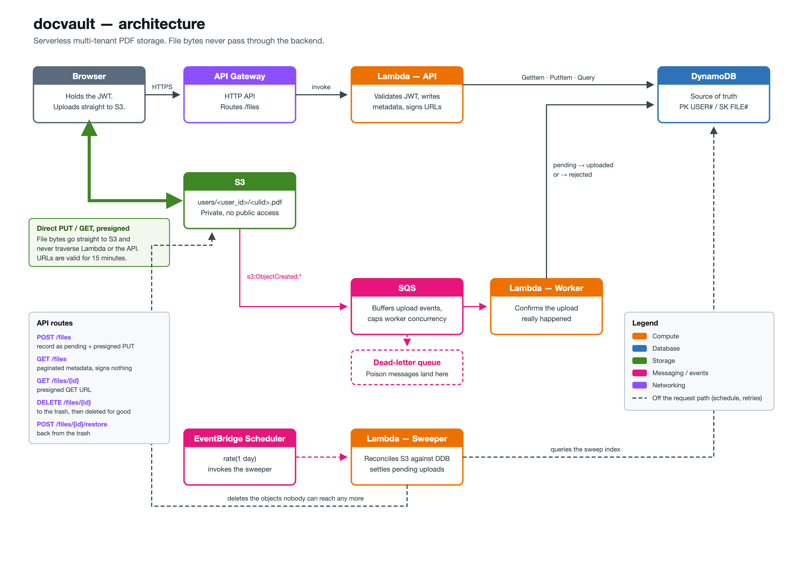

# docvault

Serverless multi-tenant PDF storage on AWS, written in Go and provisioned with Terraform, where file bytes never pass through the backend.



## The core idea

The API never touches a single byte of any file. It writes metadata to DynamoDB and hands the browser a short-lived S3 presigned URL; the browser then uploads or downloads directly against S3.

A presigned URL is not an API call. Generating one is a local HMAC-SHA256 computation over the request the client is allowed to make — bucket, key, HTTP method, expiry, and a set of headers — signed with the Lambda's own credentials. No network call to S3 is involved, which is why the operation is effectively free, and also why a URL can be signed for an object that does not exist yet. That last property is what makes the upload flow work: the record is created and the URL is signed before any bytes exist.

The consequence is that Lambda handles kilobytes of JSON regardless of whether the user uploads 12 KB or 50 MB.

## Stack

| Layer | Service |
|---|---|
| Compute | Lambda (Go, `provided.al2023`) |
| HTTP | API Gateway — HTTP API |
| Metadata | DynamoDB |
| Object storage | S3 |
| Eventing | S3 notifications → SQS + DLQ |
| Scheduling | EventBridge Scheduler |
| Observability | CloudWatch Logs |
| Identity | IAM roles, JWT (HS256) |
| Provisioning | Terraform, state in S3 with locking |
| Local testing | AWS Emulator in Docker |

## API

All routes require an `Authorization: Bearer <jwt>` header. The token must be signed with HS256 and carry an `exp` claim; anything else is a `401`. Its `user_id` claim becomes the DynamoDB partition key.

| Route | Behaviour |
|---|---|
| `POST /files` | Validates the declared filename, size and MIME type, writes the record as `pending`, returns a presigned `PUT` URL valid for 15 minutes |
| `GET /files` | Cursor-paginated metadata list, newest first. Deleted and rejected files are left out. Signs no URLs |
| `GET /files/{fileID}` | Returns metadata plus a presigned `GET` URL. `409` while the upload is still `pending`, `410` if the file is in the trash |
| `DELETE /files/{fileID}` | First call moves an `uploaded` file to the trash for 24 hours. A second call on a trashed file deletes it for good: the record moves to `deleted` and the object is removed from S3 |
| `POST /files/{fileID}/restore` | Brings a trashed file back to `uploaded` and returns a presigned `GET` URL. `409` if the file is not in the trash |

`POST /files` accepts `{"filename": "...", "size": 1234, "mime": "application/pdf"}` and returns:

```json
{
  "presigned_url": "https://bucket.s3.region.amazonaws.com/users/...",
  "upload_headers": { "Content-Type": "application/pdf" },
  "file": {
    "id": "0f9c...",
    "filename": "report.pdf",
    "size": 1234,
    "status": "pending",
    "created_at": "2026-08-10T21:14:05Z"
  }
}
```

`upload_headers` must be replayed verbatim on the `PUT`. Those headers take part in the signature, so anything else produces a 403 from S3.

The response deliberately omits the S3 key and the owner ID. The key is an infrastructure detail that would couple clients to the bucket layout, and the owner ID is already carried by the token.

## Upload flow

1. The client calls `POST /files` declaring filename, size and MIME type.
2. The API validates them, generates a ULID, builds the key `users/<user_id>/<ulid>.pdf`, and writes a DynamoDB record with status `pending`.
3. The API signs a `PUT` URL pinned to that key, with `Content-Type` and the exact `Content-Length` included in the signature, and returns it.
4. The browser `PUT`s the bytes straight to S3.
5. S3 emits `s3:ObjectCreated:*` to an SQS queue.
6. The worker Lambda consumes the message, parses the user and file IDs back out of the object key, loads the record, and checks the object's real size against the record and against the 50 MB ceiling.
7. On success the record moves to `uploaded`. On failure it moves to `rejected` and the object is deleted from S3 immediately.

### Failure modes

Every step between the client's request and the record reaching `uploaded` can fail on its own. This is the full set, with the state each one leaves behind and what recovers it.

| # | Failure | State left behind | Recovery |
|---|---------|-------------------|----------|
| 1 | Validation rejects the request | Nothing written | `4xx`, nothing to clean up |
| 2 | DynamoDB `PutItem` fails | Nothing written | `5xx`, or `409` on an ID collision; nothing to clean up |
| 3 | Client disconnects before the response arrives | `pending` record, no object | Reconciliation sweep |
| 4 | Signing fails after the record is written | `pending` record, no object | Reconciliation sweep |
| 5 | Client receives the URL and never uploads | `pending` record, no object | Reconciliation sweep |
| 6 | S3 rejects the `PUT` (size or type ≠ signature) | `pending` record, no object | Reconciliation sweep |
| 7 | Upload succeeds, the S3 event never arrives | `pending` record, **object present** | Sweep promotes the record to `uploaded` |
| 8 | Worker fails transiently (throttling, timeout) | `pending` record, object present | SQS redelivery via partial batch failure |
| 9 | Worker reads the record before it is visible | `pending` record, object present | Retried for the first three receives, then treated as an orphan |
| 10 | Event body or object key is unparseable | Object present, no usable record | Permanent failure: the object is deleted and the message dropped |
| 11 | The same event is delivered twice | Record already `uploaded` | Worker is idempotent; a non-`pending` record is left alone |
| 12 | Worker keeps failing past `maxReceiveCount` | `pending` record, object present | Message to the DLQ; the sweep still reconciles the pair |
| 13 | `DELETE` arrives while the upload is in flight | `pending` record, unchanged | `409`: only an `uploaded` file can go to the trash, so an upload is never orphaned by a delete |

**Row 3 is the one worth spelling out, because a closed tab cancels nothing.** The `context.Context` a Lambda handler receives is built by the runtime from the `Lambda-Runtime-Deadline-Ms` header, so it carries the invocation deadline and nothing else. API Gateway does not propagate client disconnects to its integration. The invocation therefore runs to completion — it writes the `pending` record, signs the URL, and returns a response that API Gateway drops on the floor, because the socket it would write to no longer exists. From the backend's point of view the request succeeded and the URL was delivered. Nothing in the request path ever learns otherwise.

**Rows 3 through 7 all leave a `pending` record, and that is exactly why the sweep cannot just delete old ones.** They do not mean the same thing, and only S3 can tell them apart, so the sweep asks it before deciding:

- **Object present** — the upload worked and the event was lost (row 7). Promote the record to `uploaded`. This is the self-healing case, and it is the reason a `pending` record is never deleted on age alone.
- **No object, and older than the grace window** — the upload never happened (rows 3 to 6). Delete the record.

The grace window has to clear the presigned URL's 15-minute TTL, plus the transfer itself, plus event delivery latency. One hour covers all three comfortably, and the sweep runs daily. A `pending` record younger than the window is an upload that may still be in progress, not garbage.

### What the queue configuration has to guarantee

Rows 8, 9 and 12 are handled in code, but the code only works if the queue is set up to match it:

- The event source mapping must declare `FunctionResponseTypes: ["ReportBatchItemFailures"]`. Without it the `BatchItemFailures` the worker returns are ignored outright, and an invocation that returns no error deletes the entire batch — including the messages the worker explicitly asked to have redelivered.
- `maxReceiveCount` on the redrive policy must be greater than 3. The worker spends the first three receives waiting out DynamoDB's eventual consistency (row 9); a lower count sends the message to the dead-letter queue before that logic has a chance to finish.
- The visibility timeout must be at least the worker's timeout, or a slow invocation gets its own message redelivered while it is still processing it.

The Terraform sets all three: `ReportBatchItemFailures` on the event source mapping, `maxReceiveCount = 5`, and a 60 second visibility timeout for a worker that times out at 10, the six-to-one ratio AWS recommends.

### Why the confirmation event comes from S3, not the client

The obvious alternative is a `POST /files/{id}/confirm` endpoint the client calls after uploading. It does not work, because the client is not a source of truth. It can close the tab mid-upload, lose connectivity, or simply call the confirmation endpoint without ever uploading anything. Only S3 knows whether the object exists, so only S3 gets to say so.

### Why a queue instead of invoking Lambda directly from S3

S3 can invoke a Lambda directly, but the delivery guarantees are weak: a limited number of retries and then the event is gone, with no way to inspect what was lost.

SQS persists the message until it is processed successfully, provides a dead-letter queue for messages that keep failing, and lets the event-source mapping cap the worker's concurrency. That last point matters more than it looks: without a cap, a burst of uploads spawns a burst of worker Lambdas that compete for the account's concurrency limit with the API Lambda, and user-facing requests start getting throttled by a background job.

The worker also reports partial batch failures, so one poisonous message in a batch does not force the redelivery of the messages next to it.

### No dual-write problem

A common shape of this feature has the backend write to a database and then publish an event, which is two writes to two systems with no shared transaction — the problem the outbox pattern exists to solve.

That problem does not arise here. The backend writes only to DynamoDB. The event is published by S3, atomically with the object write, as a property of the object existing. There are never two writes to keep in step, so there is nothing to reconcile between them and no outbox to maintain.

## Trash and reconciliation

`DELETE` works in two steps, like a desktop trash. The first call moves an `uploaded` file to `trashed` and sets `trashExpiresAt` 24 hours ahead: downloads stop (`GET` answers `410`) but the bytes stay. Until then `POST /files/{fileID}/restore` brings the file back to `uploaded`. A second `DELETE` on a trashed file is the permanent one: the record moves to `deleted`, the object is removed from S3, and the record is flagged `s3Deleted`.

`deleted` and `rejected` records are kept as history for 30 days, hidden from the listing. Closing a record sets `expiresAt`, and the table's TTL removes it once that time has passed, for free and without a job.

The permanent delete is ordered deliberately: mark the record first, delete the object second. The two possible intermediate states are not equally bad. A live object whose record says `deleted` is an invisible orphan costing fractions of a cent. A deleted object whose record says `uploaded` is a broken link the user clicks and a support ticket. Only one of those is acceptable, so the write that closes the user-visible door happens first.

That ordering leaves orphaned bytes behind whenever the second step fails, which is what the reconciliation job exists to clean up. It reads DynamoDB as the source of truth and reconciles S3 against it: deleting objects whose record is `deleted`, `rejected` or trashed past its retention, and clearing `pending` records whose upload never arrived.

The job finds that work without scanning the table. Every record that may need cleaning carries `gsiPK = SWEEP#<status>` and `gsiSK = <due time>`, the keys of a sparse index: `uploaded` files and records whose object is already gone (`s3Deleted`) leave those attributes out, so they never appear in it. One query per status returns exactly the records that are due.

The job is the sweeper Lambda (`cmd/sweeper`), invoked once a day by EventBridge Scheduler. Each run goes through four statuses:

| Status | Due when | What the sweeper does |
|---|---|---|
| `trashed` | `trashExpiresAt` has passed | Moves the record to `deleted`, deletes the object, sets `s3Deleted` |
| `deleted` | right away | Deletes the object left behind by a failed permanent delete, sets `s3Deleted` |
| `rejected` | right away | Same, for a rejected upload whose object survived |
| `pending` | one hour after `createdAt` | Asks S3: object present → `uploaded`; no object → the record is deleted |

Every write is conditional on the status the sweeper read, so a file that changes while it is swept (a late worker, a restore) makes the write fail and is skipped rather than overwritten. One run reads at most 500 due files per status; a backlog is worked through over the following runs. The sweeper's role also gets `s3:ListBucket`: without it, `HeadObject` on a missing key answers `403` instead of `404`, and an abandoned upload would look like an error instead of an absence.

### Why reconciliation instead of tag-based lifecycle rules

S3 lifecycle rules can expire objects by tag, so an appealing alternative is to tag an object `status=deleted` and let a lifecycle rule remove it a day later.

It does not hold up. Tagging an object is itself an S3 API call, so it fails under exactly the same conditions as the delete it is supposed to compensate for — the same throttling, the same credential expiry, the same network partition. A compensating action that depends on the system that just failed is not a compensation. It has to read from an independent source of truth, which is what a scheduled job reading DynamoDB does.

Lifecycle rules still earn their place for things that need no external knowledge: aborting incomplete multipart uploads, and expiring a staging prefix.

## Design decisions

**Presigned URLs instead of proxying.** Proxying the bytes through Lambda would burn GB-seconds on a function doing nothing but copying a stream, add API Gateway data transfer on top, and cap uploads at Lambda's 6 MB request payload limit — well under the 50 MB the product allows. The presigned URL moves the transfer to a service designed for it and leaves the backend handling metadata.

**Authorization is structural, not procedural.** The JWT's user claim is what builds the DynamoDB partition key. A request for another user's file does not fail an ownership check — it queries a partition the requester does not own and comes back empty. There is no `if file.OwnerID != claims.UserID` to forget, because there is no code path where the wrong user's data is in hand to be checked.

**Server-generated S3 keys.** Keys are `users/<user_id>/<ulid>.pdf`, built server-side from the token claim and a fresh ULID. The ID is a ULID rather than a UUID because the listing pages straight off the sort key: a random UUID would page in arbitrary order, while a ULID's leading timestamp makes a descending key scan mean "newest first". The client-supplied filename is display metadata that never touches the key. Using it directly would let a client submit `../../users/other/file.pdf` and write outside its own prefix. The prefix then does triple duty: it scopes IAM policies per user, it distributes load across S3 partitions, and it carries the user ID inside the S3 event so the worker can find the record without a lookup table.

The layout is defined once, in `domain.S3KeyFor`, with `domain.ParseS3Key` as its inverse right next to it. Two independent definitions of the same path is how the key and the record drift apart.

**Idempotency, because SQS is at-least-once.** The same upload event can be delivered more than once, so the worker must treat a duplicate as success rather than as an error. Returning an error on a duplicate would send a perfectly healthy message around the retry loop and into the dead-letter queue with nothing actually broken.

**Conditional writes instead of read-then-write.** Every status change goes through `Transition`: a `PutItem` with `ConditionExpression: #status = :from`, so it only succeeds if the stored status is still the one the code read. The check is atomic with the write, which leaves no window for a concurrent worker or request to slip in between; the loser gets a `409`. When the condition fails, `ReturnValuesOnConditionCheckFailure: ALL_OLD` returns the stored item, which tells a missing file (`404`) apart from one whose status moved on (`409`). The whole item is rewritten rather than patched, so the sweep index keys are always recomputed from the new status. Inserts use `attribute_not_exists(PK)`, so an ID collision fails instead of overwriting.

**No credentials anywhere.** Nothing in this repository holds an AWS access key. Each Lambda assumes an IAM role and the runtime receives rotating temporary credentials from the environment. The only secret in the system is the JWT signing key.

## Known limitations

- **A presigned URL is a bearer token.** Anyone holding it can use it until it expires, and it is fully self-contained — there is no server-side session to revoke. A 15-minute TTL is the only defence. Handing one out over a channel that logs URLs would leak access to the object.
- **Content type is declared, not verified.** The presigned `PUT` pins `Content-Type` and the exact `Content-Length` inside the signature, so an oversized or mislabelled upload is rejected by S3 before any bytes are stored. But that only enforces what the client *declared*: a ZIP sent as `application/pdf` at the right size still gets through. Real validation means reading the first bytes of the object in the worker and checking for the `%PDF-` magic number, which is not implemented.
- **No CDN.** Every download hits S3 directly. CloudFront with an Origin Access Control belongs in front of the bucket at real volume, both for latency and for egress cost.
- **No multipart upload.** A single `PUT` caps out at 5 GB and cannot retry individual parts, so a failure near the end of a large upload restarts the whole transfer. Irrelevant under a 50 MB limit, and a blocker the moment that limit moves.
- **The frontend polls.** There is no push channel, so a client watching a `pending` file has to poll `GET /files/{id}` until the worker flips it to `uploaded`.
- **Single-region, no replication.** Bucket and table live in one region.

## Running it

`make build` compiles both Lambdas for `provided.al2023` on arm64 (the runtime expects the executable to be called `bootstrap`) and zips them into `build/`. The zips are byte-for-byte reproducible, so rebuilding unchanged code never shows up as a change in `terraform plan`.

### Locally, against the AWS Emulator

The whole flow can be tested without an AWS account. [AWS Emulator](https://github.com/aws/aws-emulator) plays DynamoDB, S3 and SQS, and [AWS SAM CLI](https://docs.aws.amazon.com/serverless-application-model/latest/developerguide/using-sam-cli.html) runs the Lambdas in Docker with the same `provided.al2023` image AWS uses. You need Docker, Go, Terraform, the AWS CLI, SAM CLI and `jq`.

```bash
make emulator      # starts the emulator on https://127.0.0.1:9297
make infra-local   # builds the Lambdas, creates the state bucket and applies the Terraform
```

`local/env.sh` points the AWS CLI, the SDKs and Terraform at the emulator instead of AWS, and sets the local values of the Terraform variables. After `source local/env.sh`, every `aws` command in that shell goes to the emulator:

```bash
aws dynamodb describe-table --table-name docvault-files
aws s3 ls
```

The emulator keeps everything in memory, so `make emulator-stop` wipes it and the next `make infra-local` starts from scratch. It serves the AWS APIs but does not run Lambda code, and it does not evaluate IAM policies: permissions are only proven on AWS.

Then run the code. `make api` serves the API on `http://127.0.0.1:3000`: SAM reads the routes from `local/template.yaml`, turns each request into the same payload 2.0 event API Gateway sends, and invokes the API Lambda against the emulator. In another terminal:

```bash
TOKEN=$(make -s token)    # a test JWT for local-user, signed with the local secret
AUTH="Authorization: Bearer $TOKEN"

curl -X POST http://127.0.0.1:3000/files -H "$AUTH" \
  -d '{"filename":"test.pdf","size":1234,"mime":"application/pdf"}'
# upload with the presigned_url from the response; the body must be exactly 1234 bytes
curl -X PUT --cacert ~/.aws/emulator/9297/ca.pem -H 'Content-Type: application/pdf' \
  --data-binary @test.pdf '<presigned_url>'

make worker               # hands the queued S3 events to the worker Lambda
curl http://127.0.0.1:3000/files/<id> -H "$AUTH"      # now uploaded, with a download URL
curl -X DELETE http://127.0.0.1:3000/files/<id> -H "$AUTH"   # to the trash; again to delete for good

make sweeper              # one run of the sweeper, as EventBridge Scheduler would trigger it
```

`make worker` does by hand what the event source mapping does on AWS: it reads up to ten messages, invokes the worker with them, and deletes the ones the worker did not report as failed. Locally the mapping is created disabled (`queue_trigger_enabled = false`), because the emulator would pick the messages up, fail to invoke the Lambda and move them to the DLQ.

Two details make the Lambdas reach the emulator from inside their containers. The emulator's certificate is only valid for `localhost`, so the containers share a Docker network with it and resolve `localhost` to its address. And the S3 client uses path-style URLs (`S3_USE_PATH_STYLE`), because `bucket.localhost` is not covered by that certificate; on AWS the variable is unset and the default virtual-hosted URLs are used.

### On AWS

The state lives in an S3 bucket with versioning and locking. Create that bucket once, outside this Terraform, so a `destroy` can never delete its own state:

```bash
aws s3api create-bucket --bucket <state-bucket> --create-bucket-configuration LocationConstraint=eu-west-1
aws s3api put-bucket-versioning --bucket <state-bucket> --versioning-configuration Status=Enabled
```

Then build and provision:

```bash
make build
cd infra
cp terraform.tfvars.example terraform.tfvars   # fill in your values
terraform init \
  -backend-config="bucket=<state-bucket>" \
  -backend-config="key=docvault/terraform.tfstate" \
  -backend-config="region=eu-west-1" \
  -backend-config="use_lockfile=true"
terraform plan
terraform apply
```

Tear everything down with `terraform destroy`. The bucket must be empty first, because the S3 module does not set `force_destroy`.

The Terraform lives next to the code because it only describes this service: a new route or environment variable changes both in the same commit.

## Repository layout

```
cmd/
  api/            entrypoint for the HTTP Lambda
  worker/         entrypoint for the SQS consumer Lambda
  sweeper/        entrypoint for the sweeper Lambda, run daily by EventBridge Scheduler
internal/
  domain/         entities, statuses, errors, S3 key format — no AWS imports
  handler/        use cases, HTTP router, SQS worker, transport DTOs
  adapter/
    auth/         JWT signing and validation
    repository/   DynamoDB access, item mapping, cursor encoding
    storage/      S3 presigning and deletion
infra/            Terraform: root module and one module per AWS service
local/            AWS Emulator image, env.sh, the local backend config, the SAM template and scripts
docs/             architecture diagram (SVG source + PNG)
Makefile          build, emulator, emulator-stop, infra-local, api, worker, sweeper, token
```

`internal/domain` depends on nothing. The adapters depend on the ports declared alongside the use cases, so swapping DynamoDB or S3 means writing a new adapter rather than touching the business logic.

## Cost

At this volume everything sits inside the AWS free tier, and more importantly nothing runs when idle. There is no NAT Gateway, no RDS instance, no load balancer, and no VPC-attached Lambda — the four line items that usually turn a hobby project into a monthly bill. Lambda, DynamoDB on-demand, SQS and API Gateway all bill per request; S3 bills for the bytes actually stored.

Generating a presigned URL costs nothing at all: it is a local HMAC computation, not an AWS API call.

## License

[MIT](LICENSE)
